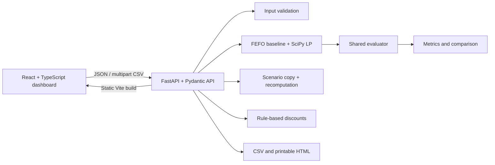

# FreshRoute AI

**Less waste. Smarter routes. Better margins.**

FreshRoute AI is a decision-support MVP for small and medium fresh-produce distributors. It determines which batches can be sent to which markets within estimated shelf-life and route-capacity limits, compares a transparent earliest-expiry-first (FEFO) baseline with a contribution-maximizing linear program, simulates operating changes, and exports the computed results.

> All bundled inventory, prices, market demand, travel/handling times, capacity, shelf life and resulting outcomes are illustrative synthetic data. They are not official statistics, live market prices, verified forecasts, or guarantees of physical delivery.

## User workflow

1. Load the bundled synthetic dataset or upload an inventory CSV.
2. Review/edit batch and destination assumptions; run backend input validation.
3. Generate a plan and inspect feasible allocations, remaining stock and diagnostics.
4. Compare the optimizer and FEFO baseline on identical inputs.
5. Run a travel-time, demand or capacity scenario; the original data remains unchanged.
6. Review deterministic discount rules and export allocation/comparison CSV or a printable HTML summary.

## Architecture



### Project structure

- `backend/app/models.py`: strict Pydantic request and result contracts.
- `backend/app/data.py`: deterministic synthetic sample.
- `backend/app/planner.py`: LP optimizer, FEFO baseline, explanations, and constraint diagnostics.
- `backend/app/evaluation.py`: authoritative shared economic metrics and comparison deltas.
- `backend/app/scenarios.py`: copy-on-write scenario multipliers and plan-change summary.
- `backend/app/discounts.py`: transparent deterministic residual-stock markdown rules.
- `backend/app/reports.py`: generated allocation/comparison CSV and printable HTML report.
- `backend/app/main.py`: API, CSV upload, FastAPI docs, and production static serving.
- `frontend/src`: responsive React interface, charts, editors, and API client.
- `tests`: algorithm/API tests; `scripts/evaluate_scenarios.py`: reproducible scenario evaluation.

## Technology

React 18, TypeScript, Vite 6, Tailwind CSS 3, Recharts, Lucide React; Python 3.12, FastAPI, Pydantic 2, NumPy/SciPy `linprog`, pytest. The dataset is browser-held while in use; there is no database or login requirement. There are no paid APIs, credentials, or live external data dependencies.

## Data schema and units

### Inventory CSV

The CSV upload and template use the following required header:

```csv
batch_id,commodity,quantity_kg,shelf_life_hours,handling_notes,eligible_destinations
TOM-EXAMPLE,Tomatoes,100,36,Keep shaded,PUN;MUM
```

`batch_id` must be unique; `commodity` and `batch_id` are nonblank; `quantity_kg` is positive; `shelf_life_hours` is nonnegative and estimated at dispatch; `eligible_destinations` is a semicolon-separated list of destination IDs. An empty eligibility list means no batch-specific market restriction; demand, price and all other constraints still apply. An invalid upload is rejected with row/column errors and does not replace active inventory.

### Destination inputs

Each destination has a unique ID and name, `travel_hours`, `handling_hours`, `transport_cost_inr_per_kg`, `capacity_kg`, `demand_by_commodity` (commodity → kg), and `price_by_commodity` (commodity → INR/kg). The UI editor accepts demand and price maps as semicolon-separated `Commodity: value` pairs. Time is in hours, quantities in kilograms and currency in INR. Route cost is linear per kg.

## Optimization objective and constraints

For each batch–destination pair that has positive modeled demand and a price, is eligible, and satisfies `travel_hours + handling_hours <= batch.shelf_life_hours`, the SciPy continuous LP has a nonnegative allocation variable `x[b,d]` in kg. It maximizes:

```text
sum over feasible (batch b, destination d):
  x[b,d] × (selling_price[d, commodity(b)] − transport_cost[d])
```

Subject to:

```text
sum_d x[b,d] <= available quantity[b]                         for each batch
sum_b x[b,d] <= demand[d, commodity(b)]                      for each market/commodity
sum of all commodity allocations to destination d <= capacity[d]
```

The zero-allocation solution is feasible; invalid inputs are rejected before solving, and solver failure returns a structured infeasible status rather than a fabricated assignment. Stable input ordering and variable ordering support reproducible results. The LP is appropriate for a small single-horizon MVP because it is transparent, deterministic, and directly represents divisible kilograms and linear prices/costs. It does not solve integer vehicle routing or trip sequencing.

**Capacity assumption:** one aggregate capacity in kg per destination, shared across every commodity during the single planning horizon. Capacity is not per trip. **Delivery assumption:** travel plus destination handling hours are compared with each batch's estimated remaining usable life. Shelf-life estimates are inputs, not physical guarantees.

## FEFO baseline

The baseline sorts batches by ascending estimated remaining shelf life, then batch ID. Each batch is assigned to feasible destinations in descending net contribution/kg, with destination ID as the tie-breaker. It decrements the same inventory, market demand and destination-wide capacity remaining as the optimizer. It never assigns the same stock twice. The shared evaluator applies identical prices and route costs. It is possible for the baseline to deliver more while earning less when the optimizer declines a nonpositive-contribution shipment.

## Metrics and definitions

- **Delivered / allocated kg:** sum of feasible assignments.
- **Unallocated kg:** available stock minus delivered stock; reconciled by batch.
- **Demand fulfillment:** delivered kg ÷ total modeled market demand kg × 100; 0% if total demand is zero.
- **Unfulfilled demand:** total market demand kg minus delivered kg, floored at zero.
- **Estimated unsold:** unallocated stock at the modeled planning cutoff. This is not confirmed spoilage.
- **At risk:** unallocated batches with at most 24 estimated usable hours remaining.
- **Physically expired:** not observed (`null`); the model does not infer actual expiration events.
- **Gross sales:** allocated kg × applicable destination selling price/kg.
- **Transport cost:** allocated kg × destination transport cost/kg.
- **Net revenue:** gross sales − transport cost. No other operating cost is modeled.
- **Comparison change:** optimized − baseline. Percent change is omitted when the baseline denominator is zero.
- **Discount trade-off:** residual kg × reference price × discount percentage; assumes unchanged volume at the reduced price. The application does not claim or model demand lift.

Shelf-life rejected, eligibility rejected and capacity-limited quantities are diagnostics, not separate losses added to revenue; no double-counted spoilage/lost-sales penalty is applied.

## API documentation

When the API is running, interactive OpenAPI documentation is available at `/docs` and the schema at `/openapi.json`.

| Method | Endpoint | Purpose |
|---|---|---|
| GET | `/health` | Runtime health |
| GET | `/api/sample-data` | Synthetic sample inputs |
| POST | `/api/inventory/validate` | Validate complete planning inputs |
| POST | `/api/inventory/import` | Validate and parse inventory CSV upload |
| GET | `/api/templates/inventory.csv` | Download CSV template |
| POST | `/api/optimize` | Compute optimized plan |
| POST | `/api/compare` | Compute FEFO and optimized plans plus metrics |
| POST | `/api/discounts` | Compute deterministic discount recommendations |
| POST | `/api/scenarios/simulate` | Recalculate both strategies on a scenario copy |
| POST | `/api/exports/allocations` | Generate allocation CSV for either strategy |
| POST | `/api/exports/comparison` | Generate comparison CSV |
| POST | `/api/reports/export` | Generate print-ready HTML report |

Plan requests use `{"inputs":{"inventory":[...],"destinations":[...]}}`. Scenario requests add `travel_time_multiplier` (0.5–2.0), `demand_multiplier` (0.5–2.0), and `capacity_multiplier` (0–1.5). Pydantic validation errors are returned as structured HTTP 422 responses; invalid CSV is HTTP 400 and preserves all existing data.

## Run locally

Requirements: Python 3.12, Node 22, and pnpm 11.25.0.

```bash
python3 -m venv .venv
source .venv/bin/activate
pip install -r requirements.txt
corepack enable
pnpm install --frozen-lockfile
pnpm --filter @freshroute/frontend build
uvicorn backend.app.main:app --host 0.0.0.0 --port 3000
```

Open `http://localhost:3000`. The FastAPI server serves the production Vite assets and API from the same port. For frontend development, start the API on port 8000 and Vite on 5173 in separate terminals:

```bash
uvicorn backend.app.main:app --reload --host 127.0.0.1 --port 8000
pnpm --filter @freshroute/frontend dev
```

Open `http://localhost:5173`; Vite proxies `/api` and `/health` to FastAPI.

## Tests and deterministic scenario evaluation

```bash
pytest
python scripts/evaluate_scenarios.py
pnpm --filter @freshroute/frontend typecheck
pnpm --filter @freshroute/frontend build
```

The test suite exercises the actual LP/baseline/evaluator, hard constraints, zero demand/capacity, bad values/CSV, revenue arithmetic, reconciliation, determinism, and scenario recalculation. The evaluation script reports the following actual deterministic outcomes from the current sample and scenario inputs (differences are optimized minus FEFO):

| Scenario | FEFO delivered (kg) | Optimized delivered (kg) | Optimized net revenue difference |
|---|---:|---:|---:|
| Normal operations | 2,060 | 2,060 | +₹100 |
| Short remaining shelf life | 1,620 | 1,620 | ₹0 |
| Demand spike | 2,140 | 2,140 | +₹480 |
| 14-hour transport delay | 1,960 | 1,960 | +₹100 |
| 50% route capacity | 1,130 | 1,130 | +₹13,670 |
| Low-margin routes | 2,060 | 240 | +₹33,048 |

In the low-margin case, FEFO delivers 1,820 kg more, while the optimizer earns more net revenue by declining shipments with negative contribution. Latest verified runs: **19 pytest tests passed** (one Starlette/AnyIO deprecation warning), `pyright` reported **0 errors**, frontend TypeScript type-check passed, and the Vite production build passed. Re-run the commands above to verify a fresh environment.

## Deployment

Build/run the container with Docker:

```bash
docker build -t freshroute-ai .
docker run --rm -p 3000:3000 -e PORT=3000 freshroute-ai
```

The image builds the Vite frontend and serves it from FastAPI; `/health` is the unauthenticated health path. A hosting environment must support Python 3.12/SciPy or run this Dockerfile. No public deployment is claimed unless a published version is separately verified.

## Three-minute demo

1. Open the app and point out the illustrative-data notice; click **Generate distribution plan**.
2. Review computed stock, demand fulfillment and at-risk stock; open **Distribution planner** and inspect the delivery explanation and binding constraints.
3. Open **Baseline comparison** and show net revenue, delivered kg, and any metric where FEFO or the optimized strategy is better.
4. Open **What-if simulator**, reduce shared transport capacity to 0.5×, run it, and review recalculated assignments and metric changes. Reset to demonstrate that source inputs are preserved.
5. Open **Inventory & inputs**, validate data, optionally upload the provided CSV template after editing a row, and restore the sample.
6. Open **Discounts & exports** and download an allocation CSV, comparison CSV, and printable HTML report.

## Known limitations

This MVP models one horizon and one shared aggregate capacity per destination. It treats kg as divisible and uses linear route cost and fixed selling price; it does not represent vehicle counts, trip schedules, road uncertainty, temperature histories, packing losses, labor/warehouse costs, or real demand response. The synthetic dataset and rule thresholds are demonstration inputs only. The application does not guarantee physical shelf life, a market sale, or dispatch feasibility beyond its modeled constraints.
